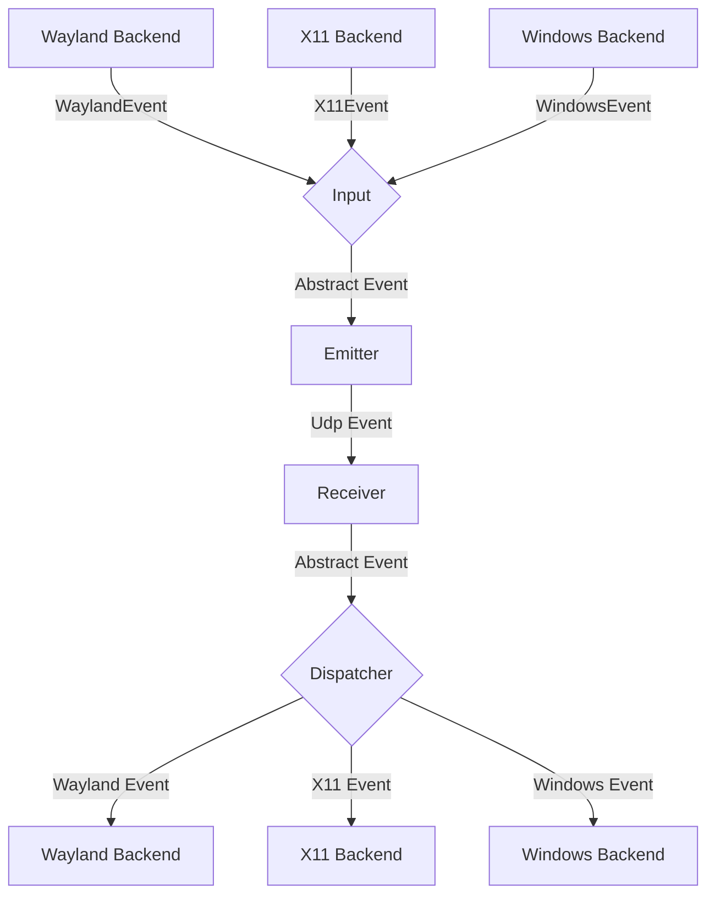
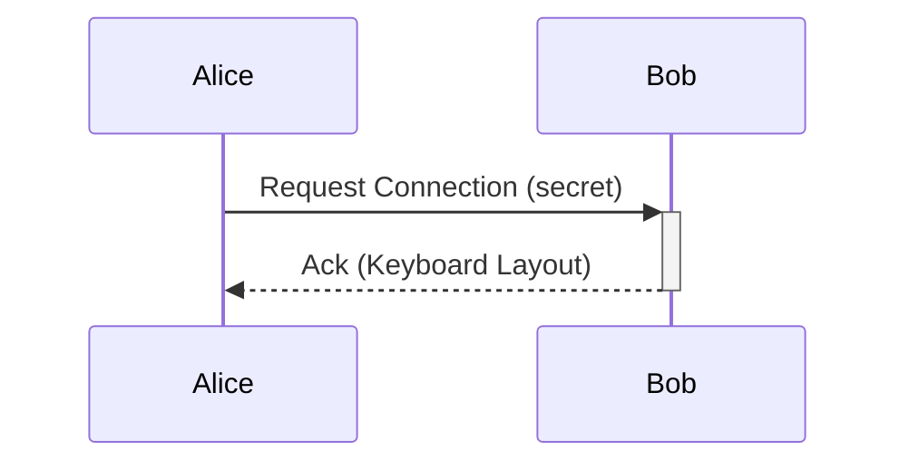

# General Software Architecture

## Events

Each instance of mousehop can emit and receive events, where
an event is either a mouse or keyboard event for now.

The general Architecture is shown in the following flow chart:


### Input
The input component is responsible for translating inputs from a given backend
to a standardized format and passing them to the event emitter.

### Emitter
The event emitter serializes events and sends them over the network
to the correct client.

### Receiver
The receiver receives events over the network and deserializes them into
the standardized event format.

### Dispatcher
The dispatcher component takes events from the event receiver and passes them
to the correct backend corresponding to the type of client.


## Requests

// TODO this currently works differently

Aside from events, requests can be sent via a simple protocol.
For this, a simple tcp server is listening on the same port as the udp
event receiver and accepts requests for connecting to a device or to
request the keymap of a device.



## Problems
The general Idea is to have a bidirectional connection by default, meaning
any connected device can not only receive events but also send events back.

This way when connecting e.g. a PC to a Laptop, either device can be used
to control the other.

It needs to be ensured, that whenever a device is controlled the controlled
device does not transmit the events back to the original sender.
Otherwise events are multiplied and either one of the instances crashes.

To keep the implementation of input backends simple this needs to be handled
on the server level.

## Device State - Active and Inactive
To solve this problem, each device can be in exactly two states:

Either events are sent or received.

This ensures that
- a) Events can never result in a feedback loop.
- b) As soon as a virtual input enters another client, mousehop will stop receiving events,
which ensures clients can only be controlled directly and not indirectly through other clients.

## Access Password (Session Admission)

Complementary to fingerprint authorization (`authorized_fingerprints`), a
receiver can configure `access_password`. The gate lives at the protocol
layer, after the DTLS handshake:

1. `verify_peer_certificate` admits peers whose fingerprint is
   unauthorized when a password is set (it is logged, never persisted).
   Their listener `Accept` event is withheld.
2. On the peer's `Hello`, the listener replies `AuthRequired{salt, nonce}`
   (capability `CAP_ACCESS_PASSWORD`, bit 2, negotiated via Hello).
3. The dialer answers `AuthPassword{proof}` with
   `SHA-256(salt ‖ nonce ‖ password)`; the listener recomputes the proof
   from its configured password and replies `AuthResult{ok}`.
4. On success the withheld `Accept` is published and the rest of the
   session flows through the unchanged handshake path; on failure the
   connection is closed and the failure counted (3 per 30 s per address —
   exceeded attempts are refused without a challenge).

Wire impact: three fixed-size event tags appended (26–28);
`MAX_EVENT_SIZE` raised to 33 bytes to fit the 32-byte auth payloads.
Serialization of existing events is unchanged — no protocol version bump.


## Reverse Tunnel Forwarding (M2c)

On a one-way network (the restricted side dials out, the exit side cannot
dial in), the restricted side can reach *network services* through the
session peer: loopback-only services, subnet hosts only the peer routes to,
and names only the peer resolves. Design: `.relay/DESIGN-m2c-tunnel-forward.md`.

Transport is a dedicated TCP channel (default `4253/tcp`, independent of the
UDP+DTLS input session so bulk traffic never competes with input) carrying
mutually-TLS'd, length-prefixed frames:

```
[tag: u8][stream_id: u32][payload_len: u32][payload]   # big-endian
```

| tag | name     | payload | notes |
|-----|----------|---------|-------|
| 1   | OPEN     | JSON `{target, port, nonce}` | initiator asks for a stream; exit validates the allow rules |
| 2   | OPEN_ACK | JSON `{ok, nonce, reason}` | `reason` is deliberately coarse |
| 3   | DATA     | raw bytes (≤16 KiB) | stream data |
| 4   | ACK      | `u32` consumed | cumulative credit return, 256 KiB window per direction |
| 5   | CLOSE    | — | half-close (TCP FIN); stream dies when both sides closed |

Stream ids are parity-split (initiator odd, exit even) so both sides can
allocate collision-free. A channel is admitted only when the peer's
certificate fingerprint is in `authorized_fingerprints` **and** that peer
holds a live input session from the same source IP — the tunnel rides the
session's trust and dies with it. The exit dials only targets matching its
`[tunnel].allow` rules (default deny); domain targets are resolved by the
exit, which is what makes split-horizon names work. mousehop-proto is
untouched: the tunnel is an application-layer protocol on its own channel.
