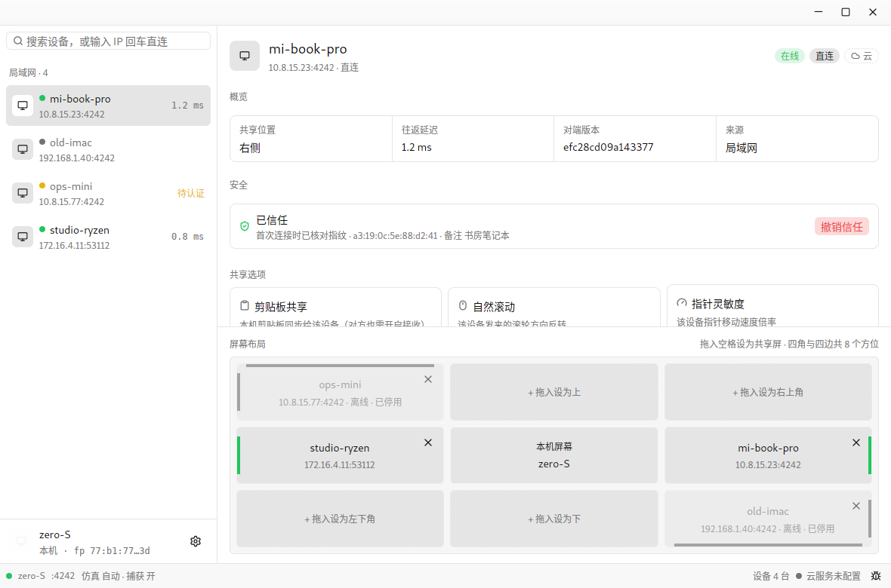

<h1>
  
  &nbsp;桌联 HopDeck
</h1>

[](https://github.com/re2zero/hopdeck/actions/workflows/ci.yml) [](https://github.com/re2zero/hopdeck/actions/workflows/cachix.yml) [](https://github.com/re2zero/hopdeck/actions/workflows/release.yml)

[](./LICENSE)

> **HopDeck（中文名「桌联」）** is a fork of [Mousehop](https://github.com/jondkinney/mousehop),
> which is a fork of [lan-mouse](https://github.com/feschber/lan-mouse) by
> Ferdinand Schober ([feschber](https://github.com/feschber)) and its
> contributors. The lan-mouse fork began in April 2026, was distributed as
> Mousehop from May 2026, and was renamed to HopDeck in October 2026. It is a
> modified version distributed under the same GNU GPL-3.0-or-later license.
> Huge thanks to the original authors and contributors — see
> [`NOTICE`](./NOTICE) for attribution details.

HopDeck is a *cross-platform* mouse and keyboard sharing software similar to universal-control on Apple devices.
It allows for using multiple PCs via a single set of mouse and keyboard.
This is also known as a Software KVM switch.

Goal of this project is to be an open-source alternative to proprietary tools like [Synergy 2/3](https://symless.com/synergy), [Share Mouse](https://www.sharemouse.com/de/)
and other open source tools like [Deskflow](https://github.com/deskflow/deskflow) or [Input Leap](https://github.com/input-leap) (Synergy fork).

Focus lies on performance, ease of use and a maintainable implementation that can be expanded to support additional backends for e.g. Android, iOS, ... in the future.

***blazingly fast™*** because it's written in rust.

- One GPUI frontend: the `hopdeck-console` control console, launched automatically when `hopdeck` runs without arguments. The `hopdeck` binary also provides the headless daemon and CLI.

<p align="center">
    
</p>


## Encryption

HopDeck encrypts all network traffic using the DTLS implementation provided by [WebRTC.rs](https://github.com/webrtc-rs/webrtc).
There are currently no mitigations in place for timing side-channel attacks.

## OS Support

Most current desktop environments and operating systems are fully supported, this includes
- GNOME >= 45
- KDE Plasma >= 6.1
- Most wlroots based compositors, including Sway (>= 1.8), Hyprland and Wayfire
- Windows
- MacOS


### Caveats / Known Issues

> [!Important]
> - **X11** currently only has support for input emulation, i.e. can only be used on the receiving end.
>
> - **Sway / wlroots**: Wlroots based compositors without libei support on the receiving end currently do not handle modifier events on the client side.
> This results in CTRL / SHIFT / ALT / SUPER keys not working with a sending device that is NOT using the `layer-shell` backend
>
> - **Wayfire**: If you are using [Wayfire](https://github.com/WayfireWM/wayfire), make sure to use a recent version (must be newer than October 23rd) and **add `shortcuts-inhibit` to the list of plugins in your wayfire config!**
> Otherwise input capture will not work.
>
> - **Windows**: The mouse cursor will be invisible when sending input to a Windows system if
> there is no real mouse connected to the machine.

For more detailed information about os support see [Detailed OS Support](#detailed-os-support)

### Android & IOS

A proof of concept for an Android / IOS Application by [rohitsangwan01](https://github.com/rohitsangwan01) can be found [here](https://github.com/rohitsangwan01/lan-mouse-mobile).
It can be used as a remote control for any device supported by HopDeck.

## Installation

> HopDeck is a young fork and is not yet packaged in distribution
> repositories (Arch, Fedora, nixpkgs). Until then, install from a release
> binary, the Nix flake, or build from source.

<details>
    <summary>Nix (flake)</summary>

- flake: [README.md](./nix/README.md)
</details>

<details>
    <summary>MacOS</summary>

- Download the `.dmg` for your Mac (Intel or Apple Silicon) from the releases page
- Open the `.dmg` and drag `HopDeck.app` into `Applications`
- Launch the app — release builds are signed with a Developer ID and notarized by Apple, so it opens with no Gatekeeper prompt
- The control console opens on launch; closing its window stops HopDeck, including input sharing
- Grant accessibility permissions in System Settings
- While this Mac is controlling a peer, HopDeck automatically keeps macOS from starting the idle screen saver or turning off the display. The keep-awake assertion ends as soon as the cursor returns to this Mac.
- If the Mac nevertheless locks after a controlled peer sleeps or disconnects, HopDeck releases capture and shows confirmed recovery status on that peer. Use the keyboard physically attached to the Mac: Shift is a harmless wake key, then wait for the status; type the Mac password only while the peer still reports **locked**. The dialog has no password field, and HopDeck never reads or transports the password. If status becomes **unavailable**, switch the monitor to the Mac or use Touch ID, Apple Watch, or your hardware input switch instead.

</details>

<details>
    <summary>Windows</summary>

- Download `hopdeck-windows-x86_64.zip` from the releases page and extract it somewhere permanent — keep `hopdeck.exe` and `hopdeck-console.exe` together in the same folder
- Run `hopdeck.exe`. It starts the daemon and opens the control console; no console window appears

**Closing the window** stops HopDeck, including input sharing. To keep sharing
while the window is out of the way, minimize it instead.

**Start with Windows.** Press <kbd>Win</kbd>+<kbd>R</kbd>, run `shell:startup`,
and drop a shortcut to `hopdeck.exe` into the folder that opens.

**Command line.** `hopdeck.exe` is a GUI application, so it prints to the
terminal only when you give it something to do — `hopdeck.exe cli list`,
`hopdeck.exe --help`, `hopdeck.exe daemon`. A plain `hopdeck.exe` typed at a
prompt stays silent and detached, so closing that terminal will not take the app
with it; set `HOPDECK_LOG_LEVEL` (e.g. `debug`) to make a GUI launch log to the
terminal anyway. As with any Windows GUI program, the prompt returns immediately
rather than waiting for the command to finish.

Crashes are recorded either way, at
`%LOCALAPPDATA%\HopDeck\logs\panic.log`.

</details>


<details>
    <summary>Manual Installation</summary>

First make sure to [install the necessary dependencies](#installing-dependencies-for-development--compiling-from-source).

Precompiled release binaries for Windows, MacOS and Linux are available in the [releases section](https://github.com/re2zero/hopdeck/releases).
For Windows, both executables are included in the .zip file; for other operating systems see [Installing Dependencies](#installing-dependencies-for-development--compiling-from-source).

Alternatively, the `hopdeck` binary can be compiled from source (see below).

### Installing desktop file, app icon and firewall rules (optional)
```sh
# install the daemon/CLI binary and the console frontend
sudo cp path/to/hopdeck path/to/hopdeck-console /usr/local/bin/

# install app icon
sudo mkdir -p /usr/local/share/icons/hicolor/scalable/apps
sudo cp apps/hopdeck/assets/hopdeck.svg /usr/local/share/icons/hicolor/scalable/apps

# update icon cache
update-icon-caches /usr/local/share/icons/hicolor/

# install desktop entry
sudo mkdir -p /usr/local/share/applications
sudo cp apps/hopdeck/hopdeck.desktop /usr/local/share/applications

# when using firewalld: install firewall rule
sudo cp firewall/hopdeck.xml /etc/firewalld/services
# -> enable the service in firewalld settings
```

Instead of downloading from the releases, the `hopdeck` binary
can be easily compiled via cargo or nix:

### Compiling and installing manually:
```sh
# compile in release mode (two invocations: see the ashpd note below)
cargo build --release
cargo build --release -p hopdeck-console

# install hopdeck and its console frontend
sudo cp target/release/hopdeck target/release/hopdeck-console /usr/local/bin/
```

### Building a .deb (Debian / Ubuntu / UOS):
```sh
# builds both release binaries (unless --skip-build) and stages the package
packaging/debian/build-deb.sh

# install the generated package
sudo apt install ./target/deb/hopdeck_*_amd64.deb
```
The package installs `/usr/bin/hopdeck` and `/usr/bin/hopdeck-console`, the
desktop entry (`/usr/share/applications/hopdeck.desktop`), the icon
(`/usr/share/icons/hicolor/.../hopdeck.*`), and AppStream metadata. Older
builds used reverse-DNS names (`com.hopdeck.HopDeck.desktop`); the app removes
that old user-local copy on launch, but a stale `hopdeck.desktop` left by a
test binary should be deleted — a user copy shadows the system entry and may
point at a deleted binary.

### Compiling and installing via cargo:
```sh
# will end up in ~/.cargo/bin
cargo install --git https://github.com/re2zero/hopdeck --package hopdeck
```

### Compiling and installing via nix:
```sh
# you can find the executables in result/bin/hopdeck and result/bin/hopdeck-console
nix-build
```
### Conditional compilation
Support for other platforms is omitted automatically based on the active
rust toolchain.

Additionally, available backends and frontends can be configured manually via
[cargo features](https://doc.rust-lang.org/cargo/reference/features.html).

E.g. if only support for sway is needed, the following command produces
an executable with support for only the `layer-shell` capture backend
and `wlroots` emulation backend:
```sh
cargo build -p hopdeck --no-default-features --features layer_shell_capture,wlroots_emulation
```
For a detailed list of available features, checkout the [Cargo.toml](./Cargo.toml)
</details>


## Development

### Repository layout

The workspace separates reusable libraries (`crates/`) from shipped
executables (`apps/`):

```
apps/
  hopdeck/            # `hopdeck` binary: daemon + CLI + launcher for the console
  hopdeck-console/    # `hopdeck-console` binary: GPUI control console
crates/
  hopdeck-input-event/     # shared input + app-identity types
  hopdeck-input-capture/   # OS capture backends (libei, layer-shell, X11, Windows, macOS)
  hopdeck-input-emulation/ # OS emulation backends (wlroots, libei, portal, X11, Windows, macOS, USB/IP)
  hopdeck-proto/           # UDP wire protocol
  hopdeck-ipc/             # daemon <-> frontend IPC (JSON over a Unix socket)
  hopdeck-video/           # screen capture + H.264 codec + transport
  hopdeck-cli/             # CLI frontend library
```

`hopdeck-input-capture` depends only on `hopdeck-input-event`, never on
`hopdeck-ipc`: capture backends produce domain values, the IPC layer
serializes them.

### Git pre-commit hook

This repository includes a local git hooks directory `.githooks/` with a `pre-commit` script that enforces formatting, lints, and tests before allowing a commit.  It is optional to enable it, but it will prevent you from committing code with failing unit tests or that needs clippy/fmt fixes. To enable the hook locally:

1. Make the hook executable:

```sh
chmod +x .githooks/pre-commit
```

2. Point git to the hooks directory (one-time per clone):

```sh
git config core.hooksPath .githooks
```

The `pre-commit` script runs `cargo fmt --all` (and fails if files were modified), clippy and tests. Clippy and tests run twice — once for the daemon workspace (`--exclude hopdeck-console`) and once for the console — because gpui's ashpd `async-io` and the daemon's ashpd `tokio` features abort when unified in one build graph.

### Dependencies & Compiling from Source
<details>
    <summary>MacOS</summary>

```sh
# Install dependencies
brew install pkg-config imagemagick librsvg
cargo install cargo-bundle
# Create the macOS icon file
scripts/makeicns.sh
# Create the .app bundle and add the console alongside `hopdeck`
(cd apps/hopdeck && cargo bundle)
cp target/release/hopdeck-console target/release/bundle/osx/HopDeck.app/Contents/MacOS/
```
</details>

<details>
    <summary>Ubuntu and derivatives</summary>

```sh
sudo apt install libx11-dev libxtst-dev libdbus-1-dev libwayland-dev libxkbcommon-dev
```
</details>

<details>
    <summary>Arch and derivatives</summary>

```sh
sudo pacman -S libx11 libxtst dbus wayland libxkbcommon
```
</details>

<details>
    <summary>Fedora and derivatives</summary>

```sh
sudo dnf install libX11-devel libXtst-devel dbus-devel wayland-devel libxkbcommon-devel
```
</details>
<details>
    <summary>Nix</summary>

```sh
nix-shell .
```
</details>
<details>
    <summary>Nix (flake)</summary>

```sh
nix develop
```
</details>

<details>
    <summary>Windows</summary>

- First install [Rust](https://www.rust-lang.org/tools/install).
- Build with `cargo build --release` and `cargo build --release -p hopdeck-console`. GPUI links only system libraries, so no
  GTK/MSYS toolchain setup is required.
</details>

## Usage
<details>
    <summary>HopDeck Console</summary>

Running `hopdeck` without arguments starts the daemon and opens the GPUI control
console (`hopdeck-console`, which must sit next to the `hopdeck` binary).

Peers are discovered over mDNS, or added by hostname/IP in the console. On the
first connection both machines show the same fingerprint; accepting it trusts
the device and lets it send input here. The local fingerprint is shown in the
console's General settings.

Authorized devices can be persisted using the configuration file (see [Configuration](#configuration)).

If the device still can not be entered, make sure you have UDP port `4252` (or the one selected) opened up in your firewall.
</details>

<details>
    <summary>Access Password</summary>

Besides per-fingerprint authorization, the receiving device can set an
`access_password` in its config file (see [Configuration](#configuration)).
Devices whose fingerprint is **not** in `authorized_fingerprints` may then
still connect, but must answer a per-session password challenge before any
input is exchanged:

- Fingerprint already authorized → connects as before; the password plays
  no part.
- Not authorized, password set → the connecting device is asked for the
  password (GUI shows a dialog); a correct answer admits **this session
  only** and never writes the fingerprint to the authorized table, so the
  next connection asks again.
- Not authorized, no password → the connection is refused as before.

Wrong answers are rate-limited: after 3 failures within 30 seconds from
the same address, further attempts are refused until the window expires.

The challenge is `SHA-256(salt ‖ nonce ‖ password)` with a fresh
per-session nonce — the password never crosses the wire and answers cannot
be replayed. Note the v1 simplification: the password itself is stored in
plain text in the config file, so protect that file.
</details>

<details>
    <summary>Command Line Interface</summary>

The cli interface can be accessed by passing `cli` as a commandline argument.
Use
```sh
hopdeck cli help
```
 to list the available commands and
```sh
hopdeck cli <cmd> help
```
for information on how to use a specific command.

</details>

<details>
    <summary>Daemon Mode</summary>

HopDeck can be launched in daemon mode to keep it running in the background (e.g. for use in a systemd-service).

To do so, use the `daemon` subcommand:

```sh
hopdeck daemon
```
</details>

## Systemd Service

In order to start hopdeck with a graphical session automatically,
the [systemd-service](service/hopdeck.service) can be used:

Copy the file to `~/.config/systemd/user/` and enable the service:

```sh
cp service/hopdeck.service ~/.config/systemd/user
systemctl --user daemon-reload
systemctl --user enable --now hopdeck.service
```

Choosing **Quit HopDeck** from the Linux tray stops the running user service
without disabling it. An enabled service therefore starts automatically again
with the next graphical session.

> [!Important]
> Make sure to point `ExecStart=/usr/bin/hopdeck daemon` to the actual `hopdeck` binary (in case it is not under `/usr/bin`, e.g. when installed manually.


## Configuration
To automatically load clients on startup, the file `$XDG_CONFIG_HOME/hopdeck/config.toml` is parsed.
`$XDG_CONFIG_HOME` defaults to `~/.config/`.

To create this file you can copy the following example config:

### Example config
> [!TIP]
> key symbols in the release bind are named according
> to their names in [crates/hopdeck-input-event/src/scancode.rs#L176](crates/hopdeck-input-event/src/scancode.rs#L176).
> This is bound to change

```toml
# example configuration

# configure release bind
release_bind = [ "KeyA", "KeyS", "KeyD", "KeyF" ]

# optional port (defaults to 4252)
port = 4252

# optional access password for incoming sessions. When set, devices whose
# fingerprint is not listed below may still connect, but must answer a
# per-session password challenge before any input is exchanged. See
# "Access Password" below.
access_password = "share-with-care"

# list of authorized tls certificate fingerprints that
# are accepted for incoming traffic
[authorized_fingerprints]
"bc:05:ab:7a:a4:de:88:8c:2f:92:ac:bc:b8:49:b8:24:0d:44:b3:e6:a4:ef:d7:0b:6c:69:6d:77:53:0b:14:80" = "iridium"

# define a client on the right side with host name "iridium"
[[clients]]
# position (left | right | top | bottom)
position = "right"
# hostname
hostname = "iridium"
# activate this client immediately when hopdeck is started
activate_on_startup = true
# optional list of (known) ip addresses
ips = ["192.168.178.156"]

# define a client on the left side with IP address 192.168.178.189
[[clients]]
position = "left"
# The hostname is optional: When no hostname is specified,
# at least one ip address needs to be specified.
hostname = "thorium"
# ips are optional: peers running hopdeck advertise every interface
# over mDNS, so a hostname alone discovers them all
# optional port
port = 4252
# optional base policy: "auto" (default) or "fastest"
mode = "fastest"
# macOS sender only: make Command act as Control for this peer
command_as_ctrl = true
# optional: cross this edge only while either Control key is held
require_crossing_modifier = true
crossing_modifier = "control"
```

Where `left` can be either `left`, `right`, `top` or `bottom`.

### macOS Command as Control

On a Mac, each outgoing client has an optional **Use Command as
Control** switch. It is off by default and is useful when the peer runs
Windows or Linux: Command+C/V/A/Z arrives there as Ctrl+C/V/A/Z.

This is a one-way alias, not a swap. Physical Control continues to act
as Control, while Command no longer acts as the peer's Super/Windows
key for that client. The setting can also be enabled with
`command_as_ctrl = true` on the corresponding `[[clients]]` entry and
is ignored when hopdeck is running on a non-macOS sender.

### Require a modifier to cross

Each outgoing client has an optional **Require Modifier to Cross** switch. When
enabled, moving into that client's configured edge does nothing unless the
selected modifier is currently held; with the modifier held, crossing behaves
exactly like automatic crossing. Either the left or right key works. On
backends that expose held-modifier state at the boundary, HopDeck checks it
before locking or hiding the pointer, so a blocked crossing rests at the local
OS edge without a grab/release delay. This preflight is skipped entirely while
the switch is off.

Choose Control, Alt/Option, Shift, or Super/Command/Windows in the GUI. The
equivalent `[[clients]]` settings are `require_crossing_modifier = true` and
`crossing_modifier = "control"`, `"alt"`, `"shift"`, or `"super"`. The
default is off, so existing clients retain automatic edge crossing.

### Multi-homed peers (interfaces, latency, locking)

A peer with more than one address — e.g. a laptop wired *and* on Wi-Fi
at the same time — advertises **every interface's** address over mDNS,
so hopdeck discovers them all without you pinning anything. By default
it races them and uses whichever connects first, which can flap onto a
slow Wi-Fi path. The GUI's **Connection Address** dropdown lists every
candidate as `<ip> — Wired/Wi-Fi · <latency>` (the interface kind is
advertised by the peer; latency is a lightweight background probe), and
offers:

- **Auto** (default): race all candidates, biased toward the
  mDNS-advertised primary interface.
- **Fastest**: prefer the lowest-latency reachable candidate and stay
  on it (sticky). It only switches when the active path dies or another
  is *sustainedly and substantially* faster, so it never flaps. Fully
  portable — works on any network with no configuration.
- **A specific address**: pin the connection to that IP **on the
  current network only**. The pin is sticky (no silent failover) and is
  scoped by a network fingerprint (the default-gateway MAC), so a pin
  set at home doesn't break connectivity on a different LAN — there,
  hopdeck falls back to the base `mode`.

`mode` persists on the `[[clients]]` entry; per-network pins persist
under a `network_locks` table (keyed by network fingerprint, numeric
IPs only). Discovered addresses, latency, and interface labels are live
runtime state and are not persisted.

## Clipboard Sync

Optional bi-directional clipboard text sync between paired peers. Disabled by default; enable per pair from the GUI or by editing `config.toml`.

### Per-pair gates

Each direction is independently gated. Both ends must opt in for clipboard text to flow that way:

- **Outgoing**: `clipboard_send` on each `[[clients]]` entry — when true, copies on this device propagate to that peer.
- **Incoming**: `clipboard_receive` on each `[authorized_fingerprints]` entry — when true, clipboard text from that peer is applied to this device's clipboard.

Defaults are `false`. Existing pairs see no behavior change on upgrade.

### Limitations

- **Text only**. No images, files, RTF/HTML, or multi-format pasteboard.
- **4 KiB max payload** (originator fingerprint + content + length prefixes, conservative against typical UDP MTU). Larger copies are dropped at the sender with a debug log; the local clipboard is unaffected.
- **UTF-8 only**. Invalid byte sequences are rejected.
- Polling-based change detection (no native pasteboard event API exists on macOS), so very rapid recopies within a single poll tick may be coalesced.

### App-source suppression

A per-OS suppression list lets you mark applications whose clipboard contents must never propagate (password managers, sensitive editors, Apple Messages, etc.). The frontmost app at the moment of copy is checked against the host-OS slot of `clipboard_suppress_apps`:

```toml
[clipboard_suppress_apps]
macos = ["com.1password.1password", "com.apple.MobileSMS"]
windows = ["1Password.exe"]
linux_wayland = ["org.keepassxc.KeePassXC"]
linux_x11 = ["KeePassXC"]
```

Each machine reads/writes only the slot matching its own OS — the others round-trip untouched, so a single config can be shared across machines (dotfiles / Syncthing / etc.) without any one machine bleeding identifiers into the wrong section.

The GUI exposes this via **Clipboard Privacy → Manage**: a searchable picker of the apps currently running on this device (with name + icon), plus a list of currently-suppressed apps with one-click removal.

### Automatic suppression on macOS

In addition to the user list, macOS clipboards stamped with the [`org.nspasteboard.ConcealedType`](https://nspasteboard.org/) UTI (the community convention used by 1Password, Bitwarden, KeePassXC, and most modern password managers) are auto-suppressed without needing a manual entry.

### Loop prevention for 3+ peer fan-out

The wire frame carries the originator's TLS certificate fingerprint. The Service tracks `(originator_fp, content_hash)` for 1 second to prevent rebroadcast cycles in N-peer topologies (A→B→C won't echo back to A).

## Roadmap
- [x] Graphical frontend (GPUI control console)
- [x] respect xdg-config-home for config file location.
- [x] IP Address switching
- [x] Liveness tracking Automatically ungrab mouse when client unreachable
- [x] Liveness tracking: Automatically release keys, when server offline
- [x] MacOS KeyCode Translation
- [x] Libei Input Capture
- [x] MacOS Input Capture
- [x] Windows Input Capture
- [x] Encryption
- [ ] X11 Input Capture
- [ ] Latency measurement and visualization
- [ ] Bandwidth usage measurement and visualization
- [x] Clipboard support (text, per-pair, with app-source suppression)


## Connection Modes

By default the session toward a peer is dialed lazily by whichever machine
wants to *send* (`direct`). For one-way networks — a controlled machine that
can dial out but cannot be reached inbound (firewalled laptop, NAT without a
port mapping) — mark the peer `reverse` on the **controlled** machine. It then
dials the controller proactively and keeps the session alive:

```toml
[[clients]]
hostname = "archer-controller"
ips = ["192.168.1.10"]
port = 4242
connect_mode = "reverse"
activate_on_startup = true
```

or with the CLI: `hopdeck cli set-connect-mode <id> reverse`. Peers behind a
port forward / DNAT work with `direct` by pointing the client at the forwarded
address — forward **UDP**, not just TCP (the transport is UDP+DTLS).

Once the reverse session is up, the controller sends input over the
connection the controlled machine dialed: mark the peer `reverse` on the
controller too (same CLI command), and its inbound session is adopted as the
controller's send path automatically. The tunnel is one-directional for
input — the controlled machine can receive input over it, but driving the
controller's pointer back across the same tunnel requires a session dialed
in the other direction (future work).

### Reverse Tunnel Forwarding

Beyond input, a machine on a one-way network can reach *network services*
through the session peer: services bound to the peer's loopback, hosts only
the peer can route to, and names only the peer can resolve. Connections ride
a dedicated TCP channel (default port **4253/tcp** — add it to your firewall
alongside 4252/udp) with mutual TLS reusing the session certificate, and are
multiplexed per stream with credit-based flow control.

The **reachable side** enables the exit with a `[tunnel]` section. The allow
list is VPN-routing-rule shaped and default-deny: entries are an exact IP
(any port), an IP with a port, a CIDR with an optional port, an exact domain
with an optional port, or a `*.` wildcard domain — **domains are resolved by
the exit side**, which is the point (split-horizon DNS, mDNS, hosts-only
names):

```toml
[tunnel]
listen = "0.0.0.0:4253"     # default 127.0.0.1:4253
allow = [
  "127.0.0.1",              # the exit's own loopback services
  "10.0.0.0/8:22",          # a subnet, ssh only
  "*.corp.local:443",       # wildcard subdomain
]
```

The **restricted side** declares per-client forwards — a local listener plus
a target, where the target may be an IP or a domain (resolved at the exit):

```toml
[[clients]]
hostname = "office-controller"
ips = ["10.8.15.60"]
connect_mode = "reverse"

[[clients.tunnel_forwards]]
listen = "127.0.0.1:2222"
target = "127.0.0.1:22"       # the peer's loopback sshd

[[clients.tunnel_forwards]]
listen = "127.0.0.1:18080"
target = "nas.local:5000"     # resolved by the peer
```

A tunnel channel is only admitted while its certificate fingerprint matches
an authorized peer that currently holds a live input session from the same
address — the tunnel lives and dies with the session, and `ssh -p 2222
localhost` on the restricted side reaches the target through the peer.
Forwards are read at daemon startup; editing them requires a restart.
Restrictions of the v1: TCP only (no UDP), no SOCKS-style dynamic
forwarding, no transparent interception.

### Screen Sharing (experimental)

The controlled machine can stream its screen to the controlling peer over a
dedicated UDP+DTLS channel (separate socket from input, same certificate and
`authorized_fingerprints` table, H.264 baseline via OpenH264). The controlled
side opts in with a `[video]` section:

```toml
[video]
enabled = true
# port = 0        # 0 (default) = ephemeral port, announced to the peer
                   # dynamically — no fixed firewall entry needed
# source = "portal" # "dummy" (default) = built-in color-bar test pattern;
                    # "portal" (Linux, `video_portal` build feature) captures
                    # the real desktop via the xdg-desktop-portal ScreenCast
                    # API (PipeWire). The first run pops the compositor's
                    # screen-picker dialog; the granted restore token is
                    # logged so a future release can persist it in this
                    # section and skip the dialog.
# width = 1280     # dummy-source geometry (the portal source announces the
# height = 720     # real negotiated display size instead)
# max_fps = 30
# parity = false   # XOR parity: one recovery packet per group of 8 data
                   # packets, so a single lost packet is rebuilt instead of
                   # dropping to the next keyframe. Off by default; both
                   # peers need this release (older receivers ignore the
                   # parity flag and misread the stream).
```

When a session is established and video is enabled, the controlled machine
announces the channel via a `VideoOffer` and the controller dials on demand;
the offer is re-announced on every new session generation. Loss handling is
LAN-tuned: the receiver detects unrecoverable gaps and answers with a one-way
keyframe request (PLI) that forces an IDR, without any retransmission
station; parity above is the optional belt-and-suspenders. v1 restrictions:
direct topology only (a `reverse` session has no inbound path for the video
dial), admission is strictly by `authorized_fingerprints` (an access password
never admits a peer to the video channel — there is no protocol-level
challenge on it to gate the stream).

The GPUI console can view the picture: a device's detail page has a
「画面 · 远程查看」 toggle that dials/hangs up the video channel
(`SetVideoView` over the IPC socket). Frames ride a separate binary Unix
socket (`hopdeck-video.sock` next to the IPC socket) so the JSON state
channel never carries pixels.

The sharing side's master switch no longer requires editing config.toml:
the settings page's 常规 tab has a 「画面共享」 switch that sends
`SetVideoEnabled` over the IPC socket. The daemon binds/tears down the
video listener live, announces the offer to (or withdraws it via
`VideoStop` from) every established direct session, persists the choice
to `[video] enabled`, and echoes the state as a `VideoShare` event so
frontends stay in sync after reconnects. Geometry, source and port stay
config-only.

## Detailed OS Support

In order to use a device for sending events, an **input-capture** backend is required, while receiving events requires
a supported **input-emulation** *and* **input-capture** backend.

A suitable backend is chosen automatically based on the active desktop environment / compositor.

The following sections detail the emulation and capture backends provided by hopdeck and their support in desktop environments / operating systems.

### Input Emulation Support

| Desktop / Backend         | wlroots                  | libei                    | remote-desktop portal    | windows                  |   macos                                | x11                | usbip              |
|---------------------------|--------------------------|--------------------------|--------------------------|--------------------------|----------------------------------------|--------------------|--------------------|
| Wayland (wlroots)         | :heavy_check_mark:       |                          |                          |                          |                                        |                    | :heavy_check_mark: |
| Wayland (KDE)             |                          | :heavy_check_mark:       | :heavy_check_mark:       |                          |                                        |                    | :heavy_check_mark: |
| Wayland (Gnome)           |                          | :heavy_check_mark:       | :heavy_check_mark:       |                          |                                        |                    | :heavy_check_mark: |
| Windows                   |                          |                          |                          | :heavy_check_mark:       |                                        |                    | :warning: experimental |
| MacOS                     |                          |                          |                          |                          |   :heavy_check_mark:                   |                    |                    |
| X11                       |                          |                          |                          |                          |                                        | :heavy_check_mark: | :heavy_check_mark: |

- `wlroots`: This backend makes use of the [wlr-virtual-pointer-unstable-v1](https://wayland.app/protocols/wlr-virtual-pointer-unstable-v1) and [virtual-keyboard-unstable-v1](https://wayland.app/protocols/virtual-keyboard-unstable-v1) protocols and is supported by most wlroots based compositors.
- `libei`: This backend uses [libei](https://gitlab.freedesktop.org/libinput/libei) and is supported by GNOME >= 45 or KDE Plasma >= 6.1.
- `xdp`: This backend uses the [freedesktop remote-desktop-portal](https://flatpak.github.io/xdg-desktop-portal/#gdbus-org.freedesktop.portal.RemoteDesktop) and is supported on GNOME and Plasma.
- `x11`: Backend for X11 sessions.
- `windows`: Backend for Windows.
- `macos`: Backend for MacOS.
- `usbip`: Kernel-level injection via a loopback [USB/IP](https://github.com/jiegec/usbip) virtual HID device. **Requires extra setup on the receiving machine (root)**: the `vhci_hcd` kernel module plus a one-time `usbip attach` — run `scripts/usbip-receiver-setup.sh attach` there once. Because injection happens at the USB stack, it works regardless of compositor support (no libei portal needed) and is therefore never selected automatically; enable it explicitly via `emulation_backend = "usbip"` or `--emulation-backend usbip`. Windows receiving requires a third-party USB/IP client driver (e.g. [usbip-win](https://github.com/cezanne/usbip-win) forks) and is considered experimental.


### Input Capture Support

| Desktop / Backend         | layer-shell              | libei                    | windows                  |   macos                                | x11 |
|---------------------------|--------------------------|--------------------------|--------------------------|----------------------------------------|-----|
| Wayland (wlroots)         | :heavy_check_mark:       |                          |                          |                                        |     |
| Wayland (KDE)             | :heavy_check_mark:       | :heavy_check_mark:       |                          |                                        |     |
| Wayland (Gnome)           |                          | :heavy_check_mark:       |                          |                                        |     |
| Windows                   |                          |                          | :heavy_check_mark:       |                                        |     |
| MacOS                     |                          |                          |                          |   :heavy_check_mark:                   |     |
| X11                       |                          |                          |                          |                                        | WIP |

- `layer-shell`: This backend creates a single pixel wide window on the edges of Displays to capture the cursor using the [layer-shell protocol](https://wayland.app/protocols/wlr-layer-shell-unstable-v1).
- `libei`: This backend uses [libei](https://gitlab.freedesktop.org/libinput/libei) and is supported by GNOME >= 45 or KDE Plasma >= 6.1.
- Hyprland automatically prefers `layer-shell` capture because monitor hotplug can make its input-capture portal publish transient pointer barriers that tear down the EIS keyboard seat. An explicit backend selection still takes precedence.
- Current peers exchange their full logical monitor topology, allowing cross-screen entry, return tracking, and cursor warps to follow exposed edges in stepped or negative-origin multi-monitor layouts. Older peers continue to use rectangular display bounds.
- On layer-shell, local fallback returns explicitly place the cursor at the current display edge after releasing the pointer lock when the compositor supports virtual-pointer input. Other compositors use the pointer-lock position hint.
- `windows`: Backend for input capture on Windows.
- `macos`: Backend for input capture on MacOS.
- `x11`: TODO (not yet supported)
